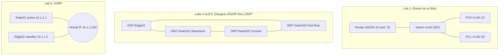

# Advanced Switching, Routing and High Availability in Cisco Packet Tracer

Six hands-on labs that take a small network from basic VLAN connectivity to a resilient, dynamically routed design: Router-on-a-Stick, Rapid PVST+ with PortFast and BPDU Guard, EtherChannel with LACP, EIGRP, OSPF and HSRP. This is Volume III of my homelab series, built and verified with Cisco IOS commands in Packet Tracer.

## Contents

- Overview
- Objectives
- Technologies Used
- Skills Demonstrated
- Environment
- Lab Architecture
- Project Scope
- Repository Structure
- Lab Summary
- Configuration Reference
- Validation and Testing
- Troubleshooting
- Security Considerations
- Lessons Learned
- Future Improvements
- Author

## Overview

The earlier volumes covered the services that keep a network running (DNS, NTP, IOS upgrades, SNMP) and VLAN configuration. In this volume I looked at how enterprise networks are designed: how traffic moves between segments, how loops are avoided, how links are combined, how routers share routes automatically, and how a gateway survives a failure.

Each lab follows the same approach: explain the problem the technology solves, configure it, verify it with `show` commands and tests, and record what I learned. Mistakes and surprises are recorded as well, not only the commands.


 
  The Glasgow office topology in Packet Tracer: DMT-Edge01 and three Layer 3 switches (Basement, Ground, First floor) with link addresses visible.


## Objectives

- Route between VLANs over a single trunk using sub-interfaces.
- Prevent switching loops with Rapid PVST+, control the root bridge, and protect access ports.
- Combine physical links into one logical link with LACP and test the resilience.
- Replace static routes with dynamic routing using EIGRP and OSPF, and compare them.
- Provide a redundant default gateway with HSRP and measure failover.
- Verify every stage with commands and tests.

## Technologies Used

| Area | Technology |
| --- | --- |
| Simulator | Cisco Packet Tracer |
| CLI | Cisco IOS |
| Switching | VLANs, 802.1Q trunking, Rapid PVST+, PortFast, BPDU Guard |
| Link aggregation | EtherChannel, LACP (IEEE 802.3ad) |
| Routing | Router-on-a-Stick, EIGRP (AS 1), OSPF (process 1, Area 0), /30 point-to-point addressing |
| High availability | HSRP (group 1, preemption, tuned timers) |

## Skills Demonstrated

| Skill | Lab |
| --- | --- |
| Inter-VLAN routing, trunk configuration, 802.1Q sub-interfaces | Lab 1 |
| Spanning tree tuning, root bridge design, access-port protection | Lab 2 |
| Link aggregation and failure testing | Lab 3 |
| Layer 3 switching, subnetting with /30 links, EIGRP | Lab 4 |
| OSPF and protocol comparison | Lab 5 |
| First-hop redundancy and failover testing | Lab 6 |
| Baseline-first troubleshooting | Troubleshooting |
| Technical documentation | This repository |

## Environment

| Item | Detail |
| --- | --- |
| Platform | Cisco Packet Tracer |
| Series | The Homelab Project, Volume III |
| Scenario | Network Infrastructure Lab Series (Dan Mill Training), with Glasgow and Jakarta offices |
| Devices | Routers, Layer 2 and Layer 3 switches, PCs and a DHCP server, depending on the lab |

## Lab Architecture



Lab 2 uses two core switches and three access switches. Lab 3 bundles four links between two switches. Each lab guide has the full topology and addressing.

## Project Scope

**In scope:** the six labs listed above, with verification and failure tests.

**Not covered in the documentation**

- IPv6, route redistribution between EIGRP and OSPF, or multiple OSPF areas
- HSRP interface tracking (described as a limitation, not configured)
- Authentication for routing protocols
- Real hardware: everything is simulated in Packet Tracer

## Repository Structure

```
.
├── README.md
├── LICENSE
├── .gitignore
├── configs/
│   ├── lab01-router-on-a-stick.txt
│   ├── lab02-rapid-pvst-portfast-bpduguard.txt
│   ├── lab03-etherchannel-lacp.txt
│   ├── lab04-eigrp.txt
│   ├── lab05-ospf.txt
│   └── lab06-hsrp.txt
├── docs/
│   ├── 01-router-on-a-stick.md
│   ├── 02-rapid-spanning-tree.md
│   ├── 03-etherchannel-lacp.md
│   ├── 04-eigrp.md
│   ├── 05-ospf.md
│   ├── 06-hsrp.md
│   ├── troubleshooting.md
│   ├── command-reference.md
│   └── lessons-learned.md
└── screenshots/
    └── README.md                  Index of expected screenshots
```

## Lab Summary

| Lab | Problem | Solution | Key result |
| --- | --- | --- | --- |
| 1 | VLANs cannot talk to each other | Router sub-interfaces over one trunk | PC0 (VLAN 10) reaches PC1 (VLAN 20) |
| 2 | Redundant links create loops; an access switch became root | Rapid PVST+, core root bridges, PortFast and BPDU Guard | Core Switch 01 root for VLANs 1 to 4 |
| 3 | STP blocks three of four parallel links | LACP EtherChannel | Ping survived three of four cables removed |
| 4 | Static routes do not adapt to failures | EIGRP AS 1 | Every network learned; two equal-cost paths |
| 5 | Need a vendor-neutral protocol | OSPF Area 0 | FULL adjacencies; two equal-cost paths |
| 6 | Single gateway is a single point of failure | HSRP with virtual IP | Two pings lost during failover |

## Configuration Reference

| Area | Setting |
| --- | --- |
| Lab 1 VLANs | VLAN 10 HR (`192.168.10.0/24`), VLAN 20 SALES (`192.168.20.0/24`) |
| Lab 1 trunk | `switchport trunk allowed vlan 10,20`, native VLAN 10 |
| Lab 2 STP | `rapid-pvst`; Core 01 priority 4096, Core 02 priority 8192 for VLANs 1 to 4 |
| Lab 3 EtherChannel | `channel-group 1 mode active` on Fa0/20 to 0/23, Port-Channel1 trunk |
| Lab 4 EIGRP | AS 1, `/30` transit links in `10.0.0.0/24`, LANs `192.168.1.0/24` to `192.168.3.0/24` |
| Lab 5 OSPF | Process 1, Area 0, same networks as Lab 4 |
| Lab 6 HSRP | Group 1, VIP `10.1.1.254`, priorities 110 and 90, preempt, timers 2 and 4 |

All commands are in `configs/` and explained in the command reference.

## Validation and Testing

| Lab | Test | Result |
| --- | --- | --- |
| 1 | Ping PC0 to PC1 before the router was configured | Failed, as expected (baseline) |
| 1 | Same ping after sub-interfaces | First one or two requests timed out (ARP), then succeeded |
| 2 | `show spanning-tree` after priorities set | Core Switch 01 root for VLANs 1 to 4; some Core Switch 02 ports discarding |
| 2 | BPDU Guard enabled | One port went error-disabled when another switch was connected |
| 3 | `show etherchannel summary` | Port-Channel1 up, all four members active |
| 3 | Continuous ping while removing cables | Ping continued with three of four cables removed |
| 4 | `show ip eigrp neighbors`, `topology`, `route` | Neighbours up, routes marked `D`, two equal-cost paths to `192.168.2.0/24` |
| 4 | Pings between LANs | Successful |
| 5 | `show ip ospf neighbor` | Neighbours FULL, routes marked `O`, two equal-cost paths |
| 6 | `show standby brief` | Edge01 Active, Edge02 Standby |
| 6 | Continuous ping to the VIP while Edge01 was disconnected | Two timeouts, then recovery through Edge02 |

## Troubleshooting

Lab 1 recorded a real problem: the first ping between VLANs failed after both devices were configured. I worked through the configuration layer by layer and concluded the delay was ARP and Packet Tracer’s learning time. See Troubleshooting for the method and the checks I use for each protocol.

## Security Considerations

- Trunks carry only the VLANs they need (`allowed vlan 10,20`).
- BPDU Guard shuts down PortFast ports that receive BPDUs, which stops unauthorised switches from affecting spanning tree.
- PortFast is used on access ports only, never on trunks or inter-switch links.
- The core switches are made root bridges deliberately, so an access switch can never win the election by default.
- Routing authentication was not configured in these labs.

## Lessons Learned

- Test a baseline before changing anything so the effect of a change is clear.
- Defaults are not designs: the root bridge, the native VLAN and timers should be chosen.
- Redundancy needs a protocol to manage it (STP, LACP, HSRP), otherwise it creates problems.
- Dynamic routing removes manual updates and adapts to failures.
- A simulator needs patience. Packet Tracer does not behave exactly like real equipment.

More in Lessons learned.

## Future Improvements

- Configure HSRP interface tracking and multiple HSRP groups to share load.
- Add OSPF areas and route authentication.
- Combine the labs into one design: HSRP gateways on a routed core with EtherChannel uplinks.
- Compare HSRP with VRRP.
- Repeat selected labs on real equipment.

